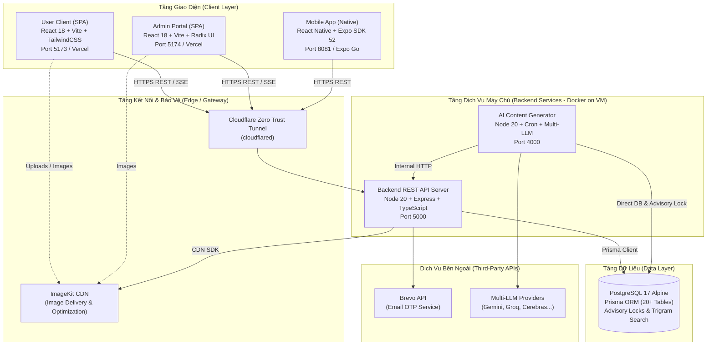
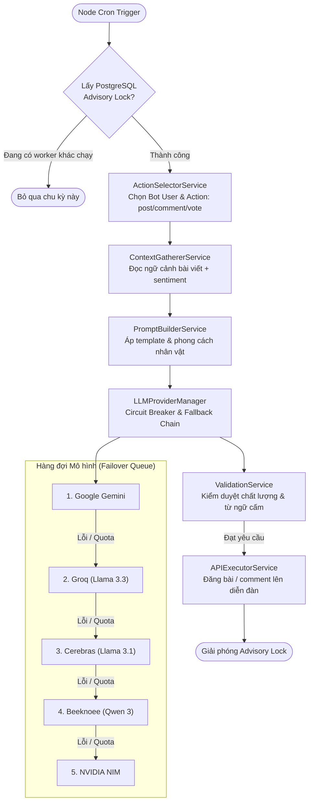

# 🏛️ Kiến Trúc Hệ Thống (System Architecture Spec)

Tài liệu đặc tả kiến trúc tổng thể, mô hình bảo mật xác thực phiên, cơ chế thời gian thực và phân hệ trí tuệ nhân tạo tự hành của dự án **Mini Forum**.

---

## 🧭 1. Kiến Trúc Tổng Thể (High-Level Architecture)

Mini Forum được tổ chức theo mô hình **Monorepo** với 5 hệ thống thành phần độc lập:



---

## 🔐 2. Kiến Trúc Bảo Mật Xác Thực (Auth Security Architecture)

Dự án áp dụng mô hình bảo mật phiên **Dual-Token** tiêu chuẩn doanh nghiệp, loại bỏ hoàn toàn việc lưu trữ token trong `localStorage` nhằm triệt tiêu nguy cơ bị đánh cắp qua tấn công Cross-Site Scripting (XSS).

```
[ Client (Browser) ]                                  [ Backend API Server ]
        │                                                       │
        │── 1. POST /auth/login (email + password) ────────────►│
        │                                                       │ (Xác thực thông tin)
        │◄── 2. Response Body: { accessToken, user } ───────────│
        │       Set-Cookie: refreshToken (HttpOnly, SameSite) ──│
        │                                                       │
   [Lưu In-Memory RAM]                                          │
        │                                                       │
        │── 3. GET /api/v1/posts (Header: Bearer accessToken) ─►│ (Verify JWT)
        │◄── Trả về dữ liệu bài viết ──────────────────────────│
        │                                                       │
    (Sau 15 phút, Access Token hết hạn)                         │
        │                                                       │
        │── 4. POST /auth/refresh (Cookie tự gửi) ─────────────►│
        │                                                       │ (RTR & Reuse Detection)
        │◄── 5. Response Body: { newAccessToken } ─────────────│ (Rotate DB Token)
        │       Set-Cookie: newRefreshToken (HttpOnly) ─────────│
        ▼                                                       ▼
```

### 2.1. Phân bổ Token
- **Access Token (JWT):**
  - Thời hạn ngắn: **15 phút**.
  - Lưu trữ: **Chỉ lưu trong bộ nhớ RAM** của ứng dụng (biến bộ nhớ trong closures/React state).
  - Không bao giờ ghi vào `localStorage`, `sessionStorage` hay cookies.
- **Refresh Token (JWT):**
  - Thời hạn dài: **7 ngày**.
  - Lưu trữ: Nằm hoàn toàn trong **HttpOnly Cookie** (`SameSite=Lax`, `Path=/api/v1/auth`, `Secure` trên production).
  - Trình duyệt tự động đính kèm cookie khi gọi endpoint `/auth/refresh` và JavaScript hoàn toàn không thể đọc được.

### 2.2. Cơ chế Xoay Vòng Token (Refresh Token Rotation - RTR)
Mỗi khi client gọi API làm mới phiên (`/auth/refresh`):
1. Backend kiểm tra tính hợp lệ của Refresh Token hiện tại.
2. Token cũ ngay lập tức bị vô hiệu hóa trong cơ sở dữ liệu (`revoked = true`).
3. Sinh một cặp Refresh Token mới và cập nhật lại vào Cookie.

### 2.3. Phát hiện Tái sử dụng Token (Reuse Detection)
Nếu kẻ tấn công đánh cắp được một Refresh Token cũ và cố tình gọi `/auth/refresh`:
1. Backend phát hiện Refresh Token này **đã bị đánh dấu revoked**.
2. Hệ thống xác định đây là một cuộc tấn công phát lại (Replay Attack).
3. **Cơ chế phòng thủ khẩn cấp được kích hoạt:** Hệ thống lập tức xóa bỏ **toàn bộ họ Refresh Token (Token Family)** của người dùng đó trong CSDL, buộc cả nạn nhân lẫn kẻ tấn công phải đăng nhập lại từ đầu.

### 2.4. Các lớp bảo vệ bổ sung
- **Helmet HTTP Security Headers:** Bật Content Security Policy (CSP), HTTP Strict Transport Security (HSTS), X-Content-Type-Options, Frameguard chống Clickjacking.
- **Xác thực OTP Email:** Đăng ký và khôi phục tài khoản thông qua mã OTP ngẫu nhiên gửi qua Brevo API, giới hạn thời gian tồn tại 5 phút.
- **Zod Validation Pipeline:** Tất cả request body, query và params đều được kiểm định kiểu dữ liệu nghiêm ngặt trước khi chuyển vào controller.

---

## ⚡ 3. Cơ Chế Thông Báo Thời Gian Thực (Real-Time SSE)

Thay vì duy trì kết nối WebSocket cồng kềnh tiêu hao nhiều tài nguyên máy chủ, hệ thống sử dụng **Server-Sent Events (SSE)** tại endpoint:
```
GET /api/v1/notifications/stream
```

### Ưu điểm kiến trúc:
- Chạy trực tiếp trên giao thức HTTP tiêu chuẩn, đi qua Cloudflare Tunnel và proxy mượt mà mà không lo bị drop kết nối.
- Cơ chế tự động kết nối lại (Auto-reconnect) tích hợp sẵn trong giao thức SSE của trình duyệt.
- Hỗ trợ đẩy tức thời các sự kiện:
  - Có người bình luận vào bài viết của bạn.
  - Có người phản hồi vào bình luận của bạn.
  - Bài viết được duyệt hoặc nhận thông báo vi phạm từ quản trị viên.

---

## 🤖 4. Phân Hệ Trí Tuệ Nhân Tạo Tự Hành (Vibe-Content)

Dịch vụ `vibe-content` là một bot nền tự động tạo ra sức sống cho diễn đàn bằng cách đóng vai các nhân vật người dùng ảo để tạo bài viết, tham gia thảo luận và bỏ phiếu vote.



### Các nguyên tắc kỹ thuật cốt lõi:
1. **PostgreSQL Advisory Locks:** Sử dụng cơ chế khóa mức CSDL để bảo đảm rằng ngay cả khi có nhiều container hoặc cron trigger đồng thời, chỉ duy nhất 1 tác vụ sinh nội dung được phép thực thi tại một thời điểm, tránh xung đột và spam API.
2. **Multi-LLM Fallback Stack:** Tự động luân chuyển giữa 5 nhà cung cấp mô hình ngôn ngữ lớn khi gặp lỗi hết hạn mức (Rate Limit / Quota Exceeded).
3. **Circuit Breaker & Cooldown:** Tạm thời đóng mạch một provider trong 2 tiếng nếu liên tục nhận lỗi 429 hoặc 5xx, giúp hệ thống không lãng phí tài nguyên gọi vô ích.
4. **Context-Aware Pipeline:** Trước khi bình luận hoặc vote, bot luôn gọi `getPostReadContext` để thực sự "đọc" nội dung bài viết, phân tích cảm xúc (sentiment) và tham khảo các bình luận đã có, bảo đảm phản hồi tự nhiên và sát chủ đề.

---

## 📱 5. Kiến Trúc Ứng Dụng Di Động (Mobile App)

Ứng dụng di động được xây dựng bằng **React Native** dựa trên nền tảng **Expo SDK 52**:
- **Expo Router:** Điều hướng theo cấu trúc thư mục (File-based routing), tương đồng với Next.js App Router.
- **Dynamic API Host Switcher:** Cho phép chuyển đổi linh hoạt địa chỉ máy chủ API trực tiếp trong giao diện cài đặt của ứng dụng (thuận tiện cho việc test local IP WiFi hoặc chuyển sang domain Cloudflare Tunnel).
- **Cross-Platform:** Tương thích cả iOS và Android thông qua Expo Go (quét mã QR) hoặc đóng gói file APK độc lập qua EAS Build.
